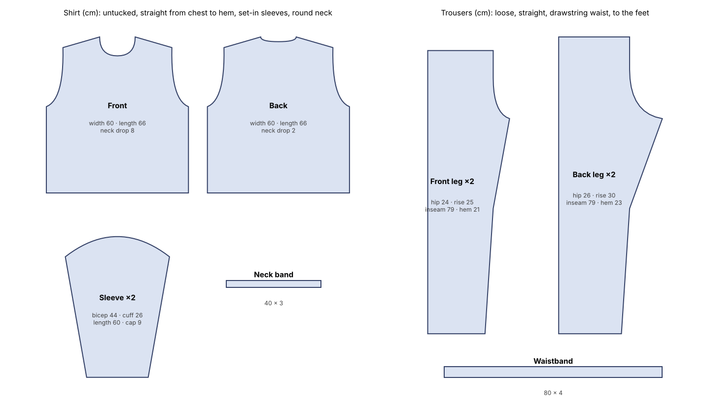
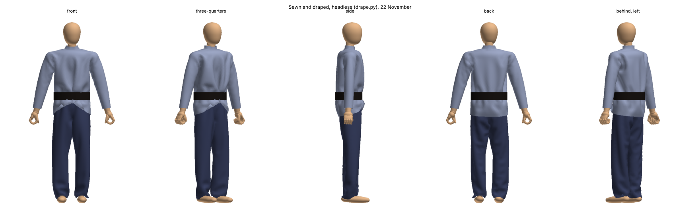
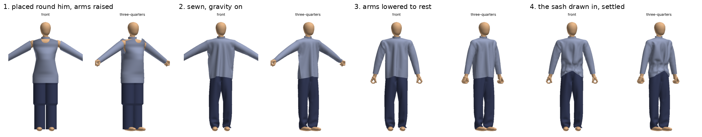
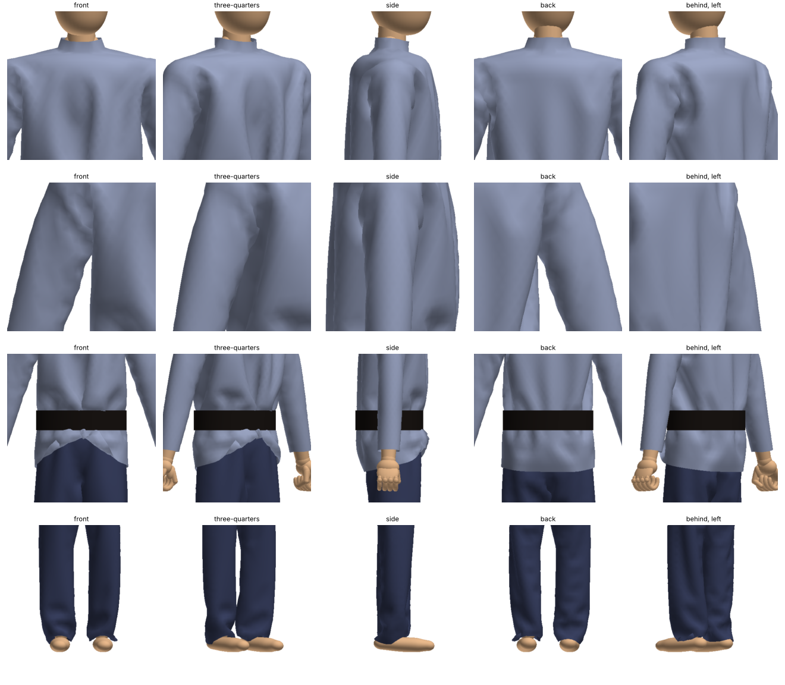
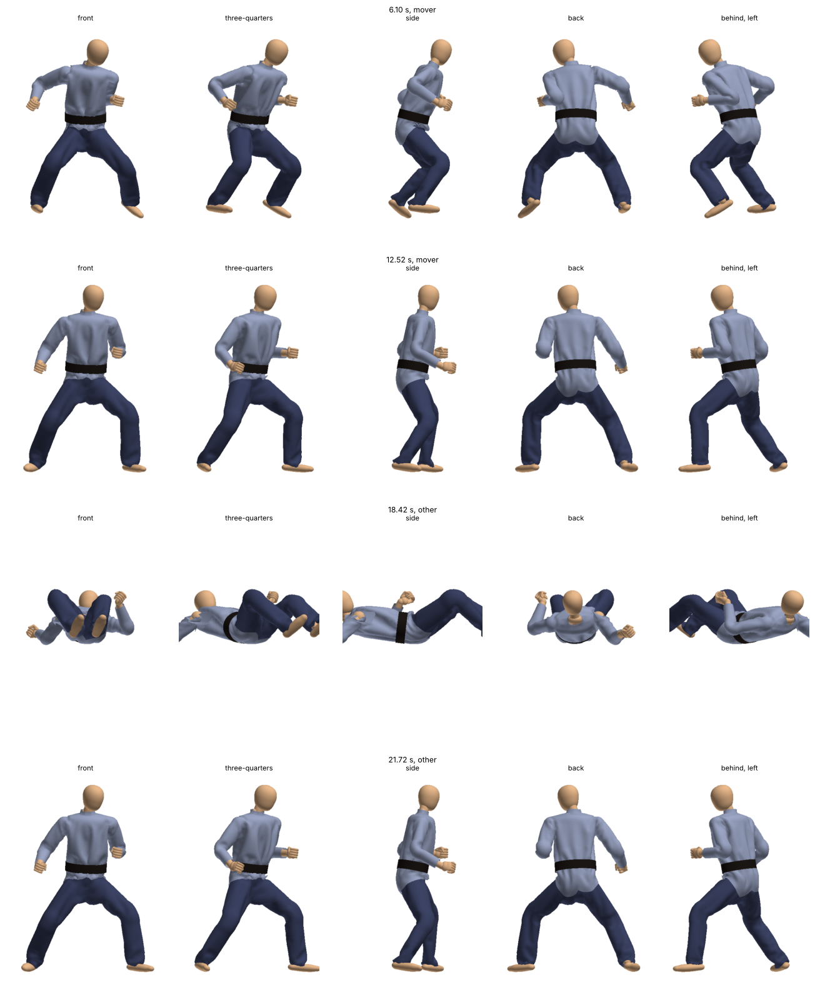
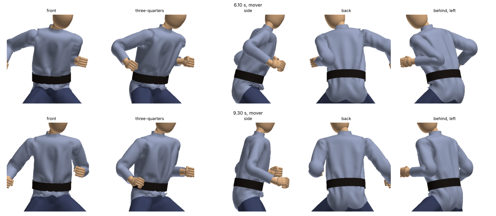
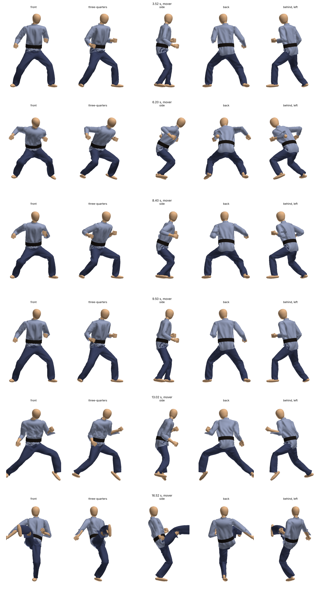
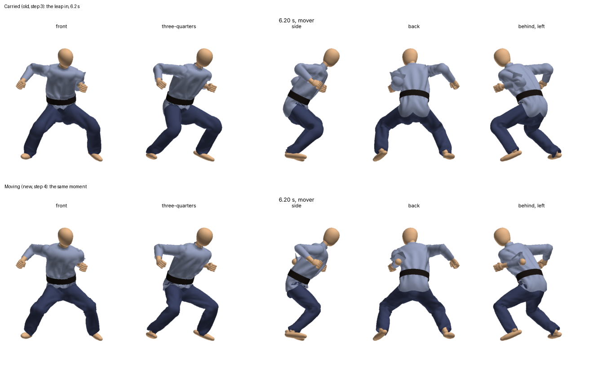
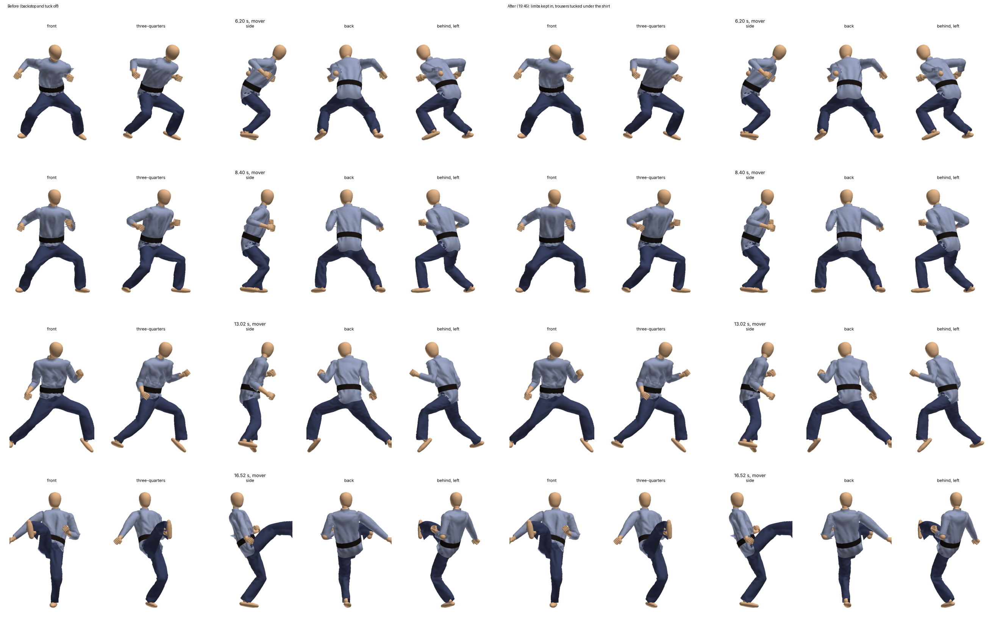

# Clothes cut and sewn like real clothes: research and plan

22 November 2026, 12:30. Live version: https://claude.ai/artifact/XtzrHrFgNy756LuoBHAsht (progress notes go there and
here). Written after his look at 12:15 and his word at 12:17: "the planning phase is super important. Make sure to do
the planning really well". His answers before it: plan and film first; the shirt untucked over the sash; a round neck
up to the neck. Its film: https://claude.ai/artifact/HpZYewCLF56HgLEup9Z8eU

## Bottom line

The clothes get cut the way real clothes are cut. Today they are tubes wrapped a set distance round each body part.
Instead, they become **flat pattern pieces drafted from real shirt and trouser blueprints**, sized to the Medium body.
The pieces are **sewn along their seams and draped on the body under gravity once**, as Marvelous Designer does. That
gives one connected shirt and one connected pair of trousers, with a collar up to the neck and folds where the fabric
is spare.

In the game the draped garment is carried by the body and **simulated as real cloth**. The fabric's own lengths come
from the flat pattern, so it falls, folds and swings. It is held firmly at the collar, shoulders and waistband and
loosely everywhere else. Every picture it is kept outside the drawn body, as it is now.

This is how films and games do it. Garments are made from patterns in Marvelous Designer or CLO, then simulated in the
engine and held to the animated body by a per-point limit ("max distance"). Unreal's and Unity's cloth both work this
way.

**Decisions for you** (details at the end):

1. Our own cloth solver (recommended), or buy Magica Cloth 2 for Unity.
2. The fabric: medium cotton (recommended), heavier canvas or light linen.
3. The fit: a loose untucked shirt and loose straight trousers to the feet, drafted below.
4. How much frame time two fighters' clothes may cost.
5. How fine the cloth is: points 2 cm apart (recommended), coarser only if the cost forces it.

Six steps. You look after step 1 (the flat pieces), step 2 (the drape) and step 4 (the moving cloth); step 4 also has
a cost gate measured in your Unity. Nothing is built until you say go.

## What your pictures of 12:15 show, and why

Every fault in them comes from the same cause. Each piece is a tube kept a set distance off the skin, so it copies the
body's shape instead of hanging from it.

| What you saw | Why it happens today |
| --- | --- |
| No cloth-like folds; it "sits over the frame" | Every point has a home a fixed gap off the skin. Nothing has spare fabric to fold, and the wobble only lets points swing round their homes. |
| The dip at the waist, like shrink wrap | The shirt's rings follow the waist in at a fixed gap. A real shirt hangs straight down from the chest and shoulder blades. |
| The neck left open | The shirt's body stops below the neck. There is no collar piece. |
| Ridges and flaps at the shoulders and armpits | The sleeves are separate tubes overlapping the shirt's body. Each is pushed out of the other, so they crease where they meet. |
| The mess at the crotch | The trousers are three tubes, a waist and two legs, overlapping there. The last word pushes each out of the others, and the trousers are smoothed, so they crumple into flaps. |

What stays from today's work: the baked drawn body (distance maps of the real meshes, with balls filling the joints'
hollow sockets), the last word that pushes anything still inside back out, the checks that prove it, the job on other
cores, and the playtest log of what the cloth does.

## How clothes are really made: patterns, sewing, draping

Garment tools copy the tailor: flat pieces are cut, sewn and then hang on a body under gravity. The 3D shape, and the
folds, are never modelled. They come from the cut.

- **Marvelous Designer and CLO** are built on real pattern-making ([SIGGRAPH blog](https://blog.siggraph.org/?p=14847)).
  Epic's [sweater tutorial](https://dev.epicgames.com/documentation/en-us/uefn/making-a-sweater-with-marvelous-designer-in-unreal-editor-for-fortnite)
  for Unreal runs like this: load the body (arrangement points on); start from a T-shirt pattern; tighten the neckline
  and armholes; build the collar from a rectangle the length of the neckline; sew the pieces segment to segment,
  checking that sewn edges are the same length; simulate after each change. The collar gets a stiffer fabric than the
  body.
- **Arrangement points** sit on the avatar so each flat piece can be put round the right part before sewing: front
  piece in front of the chest, sleeves round the arms
  ([Creative Bloq](https://www.creativebloq.com/how-to/create-3d-clothes-with-realistic-creases-and-folds)).
- **Patterns can be drafted by code from body measures.** [GarmentCode](https://arxiv.org/html/2306.03642v2) (ETH
  Zurich, SIGGRAPH Asia 2023) writes shirts, trousers and dresses as programs of panels and seams, from body
  measurements and design parameters. Tools like it exist because Clo3D is built for single designs, not parametric
  ones.
- **Sewing in a simulator.** Each panel is triangulated in 2D. Stitched edges get the same number of points, and the
  simulation pulls each pair together ([Dress-1-to-3](https://arxiv.org/pdf/2502.03449)). NVIDIA's
  [Bolt](https://arxiv.org/pdf/2504.17614) (2025) clothes characters at scale the same way. It keeps seam pairs as
  vertex groups that move as one, and collides the cloth with a distance field of the body. It damps speeds by 90% a
  step at first, because the panels start tangled. It drapes the inner garment first, freezes it and adds it to what
  the next garment collides with. Then it copies skinning weights from the body for animation.
- **Real lengths, not shrink-wrap.** A garment's rest lengths are the flat pattern's lengths. Cloth hardly stretches
  but bends and buckles freely. Some draping methods keep every edge between a minimum and a maximum length instead of
  a spring ([Dassault patent](https://image-ppubs.uspto.gov/dirsearch-public/print/downloadPdf/10223830)). That spare
  length is what makes folds when an elbow bends or a shirt hangs.

**For us:** we cannot run Marvelous Designer here, and buying it for one shirt is not needed. We do what GarmentCode
and Bolt do, in our own code: draft the pieces from the Medium's measures, put them round the body, sew, drape headless
with the same solver the game will run, and save the result.

## How games run such clothes

Games take the draped garment, skin it to the skeleton, and simulate it as cloth on top of that skinned shape. A
per-point limit keeps every point near where the skinned garment would be.

| Engine or tool | What it does | What it means for us |
| --- | --- | --- |
| [Unreal, Chaos Cloth](https://dev.epicgames.com/documentation/en-us/unreal-engine/clothing-tool-in-unreal-engine) | **Max distance**: how far a point may move from its skinned place, painted per point. **Backstop**: a sphere that point may not enter. A point with max distance 0 is [not simulated at all](https://dev.epicgames.com/documentation/unreal-engine/API/Plugins/ChaosClothAssetDataflowNodes/FChaosClothAsset-_20/DATAFLOW_NODE_DE-?lang=en-US): it just follows the skin. [Long range attachments](https://dev.epicgames.com/documentation/unreal-engine/API/Plugins/ChaosClothAssetDataflowNodes/FChaosClothAsset-_19) (tethers) stop a hem stretching away from where it hangs. | The same three ideas: max distance 0 at the collar and waistband, more at the hems; the drawn body as the backstop; tethers from hem to collar. |
| [Unity Cloth](https://docs.unity.com/en-us/engine/current/manual/physics-section/physics-overview/class-cloth) | Max distance and surface penetration per point; collides only with spheres and capsules; self-collision is costly. Unity has [asked users about deprecating it](https://discussions.unity.com/t/feedback-request-deprecation-of-unity-cloth/1526223). | Not usable: spheres and capsules are exactly the mistake of this morning (the drawn body is 2 to 5 cm fatter than its physics shapes). |
| [Magica Cloth 2](https://assetstore.unity.com/packages/tools/physics/magica-cloth-2-242307) | A Unity asset, $35, built on Unity's DOTS (Burst and jobs), source included; mesh cloth on skinned meshes; newer versions add a backstop and self-collision. | A real alternative, but it cannot run in my headless tests, so I could not measure it. Its colliders are shapes placed by hand, not our drawn body. |
| Proxy and render mesh ([patent](https://image-ppubs.uspto.gov/dirsearch-public/print/downloadPdf/12530858), [Unreal forum](https://forums.unrealengine.com/t/cloth-simulations-with-chaos-cloth/2837177.md)) | A coarse single-layer mesh is simulated; the finer drawn mesh follows it. | Our fallback if the cost is too high: simulate at 3 to 4 cm, draw at 2 cm. |
| [EA Swish](https://media.contentapi.ea.com/content/dam/ea/seed/presentations/seed-swish-cloth-simulation-madden-nfl.pdf) (Madden NFL 21) | Tight jerseys done by a learned deformer and normal maps, because real-time cloth does poorly on tight clothing. | Ours are loose, which is where real-time cloth does well. Fine wrinkles could later come from normal maps. |

**What I take from it:** sew and drape once; skin the result; simulate on top with max distance and tethers; collide
with the real drawn body; keep the last word.

## The Medium measured, and a first draft of the pieces

I measured the Medium (1.83 m) from its own mesh files in their rest pose, as a tailor would
(`Tools/Cloth/measure_body.py`). The arms hang about 16 degrees out from the body, like the A-pose Marvelous Designer
drapes on.

| Measure | Medium body | With ease (the garment) |
| --- | --- | --- |
| Chest, round the fullest part | 96 cm | 120 cm (loose) |
| Hips, round the seat | 80 cm | 100 cm |
| Neck, round its base | 34 cm | 40 cm neckline, 3 cm band |
| Shoulder to shoulder | about 46 cm | shoulder seam 15.5 cm each side, 4.5 cm drop |
| Arm, shoulder joint to wrist | 57 cm | sleeve 60 cm |
| Upper arm / forearm round | 32 / 25 cm | sleeve 44 cm at the top, 26 cm at the cuff |
| Thigh / shin / ankle round | 49 / 24 / 19 cm | leg 64 cm at the top, 50 at the knee, 44 at the hem |
| Crotch height from the floor | 82 cm | inseam 79 cm (hem 3 cm off the floor) |
| Waist to crotch | about 23 cm | rise 25 cm front, 30 cm back |

The first draft of the flat pieces, drawn from the code (`Tools/Cloth/pattern_draft.py`, centimetres). Step 1 refines
it.

**Shirt, 5 pieces:** front and back, each 60 cm wide and 66 cm long, straight from the chest to the hem (no waist
shaping, so it hangs). Two set-in sleeves with a low cap (9 cm), as casual shirts have. A round neck: 8 cm deep at the
front, 2 cm at the back, with a 40 × 3 cm band in a stiffer fabric, sitting at the base of the neck. The sash gathers
it at the waist.

**Trousers, 5 pieces:** two front legs and two back legs, loose and straight, a drawstring waistband (80 × 4 cm)
gathering 100 cm of hip. The back legs have the longer crotch extension (12 cm against 6 cm), as real trousers do, so
the seat has room when he bends.

These are a first draft from standard pattern rules (chest plus ease, divided by four; sleeve cap a sixth of the
armhole). [Drafting for the male figure](https://courses.ideate.cmu.edu/99-361/f2025c/wp-content/uploads/2025/08/drafting-for-the-male-figure.pdf)
gives the block rules; [Male Pattern Boldness](https://malepatternboldness.blogspot.com/2018/08/drafting-mens-shirt-pattern-from-scratch.html)
gives the shirt measures and cap heights. The code drafts them, so every number is a lever.

## The approach

Two halves. The garment is cut, sewn and draped **once**, headless. Then the game **simulates** it every picture on the
body as drawn, from that draped start.

**Once, headless (a file in the project, like the baked body):**

1. **Draft** the pieces from the measures above, in code.
2. **Cut** each piece into even triangles about 2 cm across, in 2D. Edges that will be sewn get the same number of
   points.
3. **Arrange** each piece round its place, a few cm off the body: the front curved round the chest, the back round the
   shoulder blades, each sleeve round its arm, each leg round its leg.
4. **Sew and drape**: seams pull their pairs of points together; gravity pulls everything down; the drawn body pushes
   cloth out (the baked distance maps). Speeds are damped hard at first, as Bolt does, because the pieces start apart.
   Then the seams are welded into one mesh and it settles for 2 seconds.
5. **Save** the draped points, their places on the flat pattern (the cloth's true lengths), the triangles, and which
   body parts each point rides on.
6. **Check** it: pictures from four sides, nothing inside the body, the measures under "How we prove it".

**Every picture, in the game (LateUpdate, on the body as drawn):**

1. **Its place on the body.** Every point's skinned place, carried by the one or two parts it rides on (today's homes,
   made smooth across joints).
2. **Carried on.** The cloth keeps its own motion relative to that place. So it is never a picture late (the robe's
   fault this morning), and only its swing lags, as cloth does.
3. **Small steps** (about 8 a picture): gravity and air; each thread kept to its pattern length, hard against
   stretching and soft against squashing, so spare cloth buckles into folds; a soft bend; tethers from the hems to the
   collar and waistband; the sash as a ring round the waist. Each small step pushes the cloth out of the drawn body,
   with a 5 mm thickness and some friction.
4. **The fence (max distance).** None at the neck band, shoulder seams, waistband and under the sash; growing to about
   10 cm at the hems and cuffs.
5. **The last word,** as today: every point, thread middle and face centre still inside the drawn body is pushed out.
   This is what makes "never" hold even if the steps above fail.
6. **Drawn** as one welded mesh per garment, smooth across the seams, both sides.

**Layers:** the trousers first; the shirt hangs over their waistband. Before the shirt is placed, the trousers' top is
added to what it is pushed out of.

**Folds come from four things:** spare fabric (24 cm at the chest, 12 cm round the upper arm); cloth squashed when an
elbow or knee bends; the shirt hanging from the shoulders under its weight; and a low bend stiffness. With points 2 cm
apart, folds of about 5 cm and wider show. Finer creases would need normal maps (step 6, if wanted).

The solver is the XPBD of this morning's robe in small steps
(`2026-11-22-clothes-that-never-go-into-the-body-research-and-plan.md`), moved onto the baked drawn body and the Burst
job built today.

## The cost

Real cloth costs more than today's tubes, and its cost in Unity is the biggest unknown. So the plan measures it in your
Unity before going further (step 4's gate) and has cheaper settings ready.

**The size.** The drafted pieces are 1.12 m² of shirt and 1.14 m² of trousers. Today's tubes have 5,600 points a
fighter.

| Points about | Shirt | Trousers | A fighter | Folds it can show |
| --- | --- | --- | --- | --- |
| 2 cm apart | 3,200 | 3,300 | 6,500 | about 5 cm and wider |
| 2.5 cm apart | 2,100 | 2,100 | 4,200 | about 6 to 7 cm and wider |
| 3 cm apart | 1,400 | 1,500 | 2,900 | about 8 cm and wider |

**Where the time goes.** Each small step touches every point about six times (its threads and bends) and looks up the
drawn body near it. At 8 small steps and 6,500 points that is about 300,000 thread fixes and 50,000 body look-ups a
picture, a fighter. Today's tubes, with the last word, cost 18 ms a fighter a picture headless (one core, no Burst). In
Unity they ran on other cores and your frame stayed at 18.5 ms in the middle. How much faster Burst is than my headless
build is not known; your next log's new `ms_Clothes` column will show today's real cost.

**How it is kept off your frame:**

- The shirt and the trousers are separate jobs, so two fighters use four cores at once.
- The cloth's own motion is kept relative to the body. So the job can work through a picture while the next is being
  made, and the result is laid on the body as drawn. You never see it a picture late, and the main thread does not wait
  for it.
- The last word stays on this picture's body, measured every fourth picture only.

**If it is still too slow, in this order:** points 2.5 or 3 cm apart; 6 small steps instead of 8; simulate a coarse
mesh and draw a fine one; men far from the camera carried, not simulated. In the fight of six, carried only, until you
say.

**A proposed budget:** in the labs and the dance, no more than 1 ms a fighter on the main thread; the jobs finished
within the picture; the frame no more than 2 ms slower than with no clothes.

## How we prove it

Every claim gets a number measured headless, and a picture from your Unity. The last one now comes straight from your
playtest log ("Shake him" writes the whole cloth every 1.5 s).

| What | How it is measured | Pass mark |
| --- | --- | --- |
| Never inside the body | Every picture against the baked drawn body (points, thread middles, face centres); the exact mesh check every 20th picture; a torture rack of 1,000 random poses; "Shake him"; dances | No points inside. Between points at most a few in a million, under 1 mm. A body bent shut or pressed into itself counted apart, as you agreed. |
| Hangs, not hugs | The shirt between the chest and the sash, seen from the side and the back, against the straight line from chest to sash | Never further in than that line: no dip at the waist. Below the sash it hangs at least as wide as the hips plus 5 cm. |
| Up to the neck | Bare skin by rays from every vertex of the body (`coverage.py`) | Bare only above the neck band, at the hands and at the feet. |
| One piece, no seams showing | Distance across every sewn pair; the bend across the shoulder seam | Every pair welded (0 mm). No ridge where the sleeve meets the shoulder. |
| Folds like cloth | The cloth against a smoothed copy of itself (fold depth) | Standing: soft folds at the hem and under the arms. Elbow or knee bent: folds 1 cm deep or more. |
| Cloth does not stretch | Each thread against its length on the flat pattern | None longer than 105%. |
| Moves like cloth | The hem's swing in a leap and how long it takes to settle; the shiver of points when he stands still | Swing 3 to 10 cm; settled within 1 s; under 1 mm a picture when still. |
| Costs what we agreed | `ms_Clothes` and the job's time in your log; the frame time with and without clothes | The budget in the section above. |

Tools I have: the headless drawing of the real meshes with true depth (`outfit.py`); the bare-skin rays
(`coverage.py`); the torture rack (`FIGHT_CLOTHRACK`); and pictures of your Unity runs from the log
(`unitylog_outfit.sh`). New for this plan: a drawing of the flat pieces, fold depth, the hang line and the stretch
count.

## Steps

Six steps. You look after steps 1, 2 and 4; each gets a film and its yellow frames on the panel. Today's tubes stay as
the old way until the new clothes pass.

1. **The pattern.** Code drafts the pieces from the Medium's measures. Each lever is a number: ease, lengths, cap
   height, neck depth, rise. Each piece is cut into even triangles, with sewn edges given matching points.
   - You see: a drawing of the flat pieces and their numbers, like the pattern window in Marvelous Designer.
   - Pass: sewn edges match in length within 1%; every lever changes the drawing.
2. **Sew and drape, headless.** Arrange, sew, drape on the rest pose, weld, save the file.
   - You see: pictures of the draped shirt and trousers from four sides, headless, with the true-depth drawing.
   - Pass: no waist dip; neck band at the neck; nothing inside the body; seams welded; soft folds at the hem and under
     the arms.
3. **Carried on the moving body.** The draped garment rides the body as drawn (smooth across joints), with the last
   word, no simulation yet. In Unity: "Clothes:" sewn shirt and trousers (new) / tubes (old) / none.
   - Pass: never inside on the rack and in "Shake him"; cost logged.
4. **Real cloth.** The small steps, threads at pattern length, bend, tethers, sash ring, drawn-body collisions, the
   fence; on other cores, laid on the body as drawn. Levers: "Cloth weight", "Stiffness", "Bend", "Air", "Hems may
   swing". A switch "Cloth: moves (new) / carried (old)".
   - You see: "Shake him"; elbows and knees bending; a leap.
   - Pass: every mark in "How we prove it"; cost within the budget in your log. **The gate: if Unity's cost is over
     budget, the cheaper settings come before anything else.**
5. **Layers and cost.** The shirt over the trousers' waistband; the sash; light self-collision if folds pass through
   each other; the cheaper settings tuned against your logs.
6. **The look.** Hem and cuff edges with a little thickness; the colours; optional normal maps for fine creases; the fit
   levers in the lab.

Not in this plan: the fight of six (carried only, until you say); other body sizes (the same code, re-run on their
measures).

## Risks and questions

**Risks**

| Risk | What we do about it |
| --- | --- |
| The cost in Unity is too high | Step 4's gate: measured in your log before anything else; the cheaper settings in "The cost". |
| Cloth through cloth: a fold through a fold, the shirt through the trousers | "Never inside the body" is guaranteed by the last word. Cloth through cloth is not, at first. Light self-collision and the layer order come in step 5. |
| The drape tangles: a sleeve twisted, a seam crossing the body | Careful arrangement; the four-side pictures after step 2 before anything moves. Bolt notes the same weakness. |
| Loose cloth at the armpits and crotch, where two parts meet | Each point rides two parts with smooth weights, over the joint balls; the fence keeps it near; the last word keeps it out. |
| Extreme poses (arms overhead) pull the shirt up | That is what a real shirt does. The tethers and the fence stop it running away. |
| Hems and cuffs look paper-thin | A little edge thickness in step 6. |

**Questions for you** (my recommendation first):

1. **Whose cloth?** Our own solver: it collides with the real drawn body, and I can measure it headless. Or buy Magica
   Cloth 2 ($35): proven in many games, but I cannot test it here, and its colliders are hand-placed shapes.
2. **The fabric?** Medium cotton: hangs and folds readily. Or heavier canvas: hangs straighter, folds bigger. Or light
   linen: swings and flutters more.
3. **The fit?** As drafted: a loose shirt to just below the hips (66 cm long) and loose straight trousers to the feet.
   Or tighter or looser.
4. **The budget?** As proposed: 1 ms a fighter on the main thread, the frame no more than 2 ms slower. Or another.
5. **The detail?** Points 2 cm apart (folds from 5 cm), going coarser only if the cost forces it. Or start coarser and
   cheaper.

Nothing is built until you say go.

## Progress, 22 November, 14:00: steps 1 and 2 built (headless only)

His answers (12:56): our own solver; cotton; the fit as drafted; the budget, but get it working on the two fighters
first and make it fast after; points 2 cm apart. "Ok go ahead".

**Step 1, the pattern** (`Tools/Cloth/pattern.py` → `Assets/_Battler/Resources/Locomotion/GarmentPattern_Medium.json`;
the cut drawn in `2026-11-22-clothes-cut-and-sewn-pieces-cut.png`): ten pieces, 7,091 points, 24 seams with matching
points. Changed from the first draft because the drape showed it: the shirt 75 cm from the neck point over the shoulder
(66 hung to 0.97 m, above his hips); the sleeve 58 cm with a 28 cm cuff (longer ones caught on his fist, 33 cm round);
the shoulder 23.5 cm and the armhole 21.5 cm deep (sleeve cap 7.9 cm); the waistband 80 cm. Seams match in length
except the gathers on purpose (the legs into the waistband, the neck into its band) and the back inseam eased in (2%).

**Step 2, sew and drape** (`Tools/Cloth/drape.py`, 75 s, the same file every run →
`Assets/_Battler/Resources/Locomotion/Garments_Medium.json`): placed round him with the arms raised 60 degrees;
trousers sewn, gravity, welded, settled; the shirt sewn outside the trousers, the arms lowered to rest, hung, the sash
drawn in, welded, settled. Measured headless against the baked body:

- Nothing inside the body: 0 points, 0 thread middles, 0 face centres (nearest 3 mm).
- Seams welded: the widest gap just before the weld 2 to 3 mm, then every pair one point.
- No waist dip: never more than 0.16 cm inside the line from chest to sash. Below the sash 107.5 cm round (his hips
  82.7). Hem 0.87 to 0.99 m.
- Up to the neck: the band's top at 1.59 m, 9 mm off his skin.
- Bare skin only above the band, at the wrists below the cuffs, and in two creases.
- Threads over 105%: 5 in the trousers (longest 113%), 26 in the shirt (longest 119%).
- Folds 1 to 4 cm, mostly below the sash and down the sleeves.

What it took: 12 solver sweeps a small step and a tied drawstring in the drape, or the trousers slid off; pieces placed
at their own width (a wide cuff stuck on his fist); the sash gathers the shirt's body only; only different pieces kept
apart (the shirt's own folds pushing apart lifted the hem 10 cm); the body kept 8 mm off (5 mm let his hip bones show
through).

**Next: step 3**, the draped garments carried on the moving body with the last word, a "Clothes:" switch in the duel
lab. Nothing in the game has changed yet.

Its film: https://claude.ai/artifact/GXntctLRobxVvfT1qj7scq

## Progress, 22 November, 15:55: step 3 built (headless only; the Burst job built blind)

His word at 14:37: "ok this looks fine, proceed".

The draped shirt and trousers are worn in the labs and the dance (Combat Feel "The Fighters Wear" 3, the new default;
duel lab "Clothes:" sewn (new) / tubes (old) / robe (old) / none). Each point is carried by its one or two nearest
parts, smooth across the joints and carried round a joint at its own distance from it; the shirt below the sash rides
the thighs too. Then the last word on the drawn body; cloth in a crease where his body is pressed into itself stays
folded in and is counted apart. In Unity it runs on other cores (`SewnJob`, never compiled here) with the main-thread
fallback.

Measured headless (both men, every picture):

- "Shake him" (24 s): points inside 2 of 27 million; thread middles 63 of 80 million; triangle centres 29 of 53
  million; the deepest 0.1 mm; the exact mesh check 1 of 4 million. About as tight as the tubes on the same build
  (middles 63 of 29 million).
- The rack (1,000 random poses at the joints' limits): points 40 of 6.6 million, middles 2,829 of 19.7 million, the
  deepest 10.5 mm: worse than the tubes there.
- Cost: 33 ms a fighter a picture on one core without Burst. Not known in Unity.

What it took: the shirt below the sash riding the thighs took the middles inside from 24,862 to 453; letting cloth in a
crease stay folded took them to 63 and the furthest push from 14 cm (a flap at a bent elbow) to under 5 cm.

Not right yet: carried, the shirt's back below the sash makes two lobes over his seat when he stands wide, and its
front hem crumples over the crotch; a thin line of skin may show in a crease. Real cloth (step 4) is the answer.

**Next: his look in Unity, then step 4** (real cloth on the moving body), its cost gated on his log.

Its film: https://claude.ai/artifact/CjdYxDWwby67VTxTNvr28r

## Progress, 22 November, 18:20: step 4 built (headless only; the Burst job built blind)

His word at 16:51: "Ok I think its coming along well. pushed the logs. lets see the next step".

The shirt and trousers move by themselves (Combat Feel "Sewn Cloth Moves", on; duel lab "Cloth:" moves (new) /
carried (old), "Pluck the cloth:", the readout "The cloth moving"). Each point is its carried place plus an offset that
moves: 4 small steps a picture, gravity as the change from the drape's down, his change of speed felt in part, a light
pull back to the drape; 4 sweeps over the threads and bends; out of the drawn body, cloth in a true crease left folded;
a fence that grows 20 cm a metre along the cloth from where it is held, at most 10 cm. Then the last word as in step 3.

Measured headless (both men, one core, no Burst), against the pass marks:

| Mark | Measured | |
| --- | --- | --- |
| Moves like cloth: settled within 1 s | after a pluck, under 1 mm a picture in 0.5 s, back where it hung in 1 s | yes |
| Moves like cloth: shiver under 1 mm when still | 0.23 mm | yes |
| Moves like cloth: swing 3 to 10 cm | the hems 3.5 cm more in the leap in (4.9 cm from carried) | yes, the low end |
| Cloth does not stretch: none over 105% | 7.7% of threads standing (carried: 13%); over 120% 1.2% (carried 8%) | **no** |
| Never inside | "Shake him": points 88 of 14.3 million, middles 2,002 of 42.5 million, deepest 2.8 mm (carried: 0, 34, 0.0 mm) | **no** |
| Folds of 1 cm at bent joints | | not measured |
| Cost | 52 ms a fighter a picture (carried 33) | not known in Unity |

Seen in the pictures: the shirt's back below the sash hangs straight down (the lobes are gone). Found in them, not in
the counts: the old fold rule left cloth pulled tight over a bent knee or elbow inside the body, and the knees showed
through in a leap; now only a true crease (the two parts' ways out facing each other) stays folded.

Not right yet: the bent shield elbow can show a spot of skin in a leap; threads stretch at that elbow; the shirt and
trousers through each other (step 5); the cost in Unity.

**Next: his look in Unity and his log's cost; if over budget, the cheaper settings first ("Small Steps" 2, "Sweeps" 2).**

Its film: https://claude.ai/artifact/Td3BUcKw15jKQTBFDVzSqE

## Progress, 22 November, 19:45: after his look at step 4 (headless only; the cost change built blind)

His look at 19:09: "Ok very nice! This is looking really good so far", with four things wrong: arms and legs push
through the cloth at times; spikes where the limbs bend; the shirt and trousers through each other; slower. His log of
19:03: the job runs on the other cores in Unity (8.25 ms a fighter), the clothes 18.3 ms of the frame (7.8 at step 3),
the frame 24.7 to 40.1 ms.

- **A backstop** (the plan's "backstop", now built): no point goes further in than his skin along its own way out.
  Points with a limb out through them: 2.0% of checks to 0.12% ("Cloth at his skin:").
- **The trousers under the shirt** drawn close to him, the shirt over them 6 mm further off ("Trousers under the
  shirt:"). Cloth through cloth is still not measured (step 5).
- **Fewer spikes:** a thread over 4 times its length in 44% of samples to 14%; still a moment of 13 to 15 times on a
  man lying with his knees bent.
- **Cheaper:** the body's push every other small step, both men's clothes worked out at once while the game goes on
  ("Both men's cloth:"; built blind). Headless 52 to 39 ms a fighter.

**Next: his look and his log's `ms_Clothes`; then step 5 (layers, cost).**

## Sources

- [Making a sweater with Marvelous Designer](https://dev.epicgames.com/documentation/en-us/uefn/making-a-sweater-with-marvelous-designer-in-unreal-editor-for-fortnite), Epic Games
- [Marvelous Designer tutorial](https://blog.siggraph.org/?p=14847), SIGGRAPH blog, 2022
- [Create 3D clothes with realistic creases and folds](https://www.creativebloq.com/how-to/create-3d-clothes-with-realistic-creases-and-folds), Creative Bloq
- [GarmentCode: Programming Parametric Sewing Patterns](https://arxiv.org/html/2306.03642v2), Korosteleva and Sorkine-Hornung, SIGGRAPH Asia 2023
- [Bolt: Clothing Virtual Characters at Scale](https://arxiv.org/pdf/2504.17614), NVIDIA, 2025
- [Dress-1-to-3](https://arxiv.org/pdf/2502.03449), 2025: sewing patterns triangulated and stitched for simulation
- [Designing a manufacturable garment](https://image-ppubs.uspto.gov/dirsearch-public/print/downloadPdf/10223830), patent: edge lengths kept within intervals
- [Clothing tool in Unreal Engine](https://dev.epicgames.com/documentation/en-us/unreal-engine/clothing-tool-in-unreal-engine): max distance, backstop
- [Chaos Cloth max distance node](https://dev.epicgames.com/documentation/unreal-engine/API/Plugins/ChaosClothAssetDataflowNodes/FChaosClothAsset-_20/DATAFLOW_NODE_DE-?lang=en-US) and [long range attachment node](https://dev.epicgames.com/documentation/unreal-engine/API/Plugins/ChaosClothAssetDataflowNodes/FChaosClothAsset-_19)
- [Unity Cloth](https://docs.unity.com/en-us/engine/current/manual/physics-section/physics-overview/class-cloth) and [its deprecation feedback request](https://discussions.unity.com/t/feedback-request-deprecation-of-unity-cloth/1526223)
- [Magica Cloth 2](https://assetstore.unity.com/packages/tools/physics/magica-cloth-2-242307), Unity Asset Store
- [Proxy mesh generation for cloth](https://image-ppubs.uspto.gov/dirsearch-public/print/downloadPdf/12530858), patent; [Chaos Cloth proxy advice](https://forums.unrealengine.com/t/cloth-simulations-with-chaos-cloth/2837177.md), Unreal forum
- [Swish: cloth for Madden NFL 21](https://media.contentapi.ea.com/content/dam/ea/seed/presentations/seed-swish-cloth-simulation-madden-nfl.pdf), EA SEED
- [Drafting for the male figure](https://courses.ideate.cmu.edu/99-361/f2025c/wp-content/uploads/2025/08/drafting-for-the-male-figure.pdf), Carnegie Mellon course notes
- [Drafting a men's shirt pattern from scratch](https://malepatternboldness.blogspot.com/2018/08/drafting-mens-shirt-pattern-from-scratch.html), Male Pattern Boldness
- This morning's plan, `2026-11-22-clothes-that-never-go-into-the-body-research-and-plan.md`: the baked body, the last word, the solver
