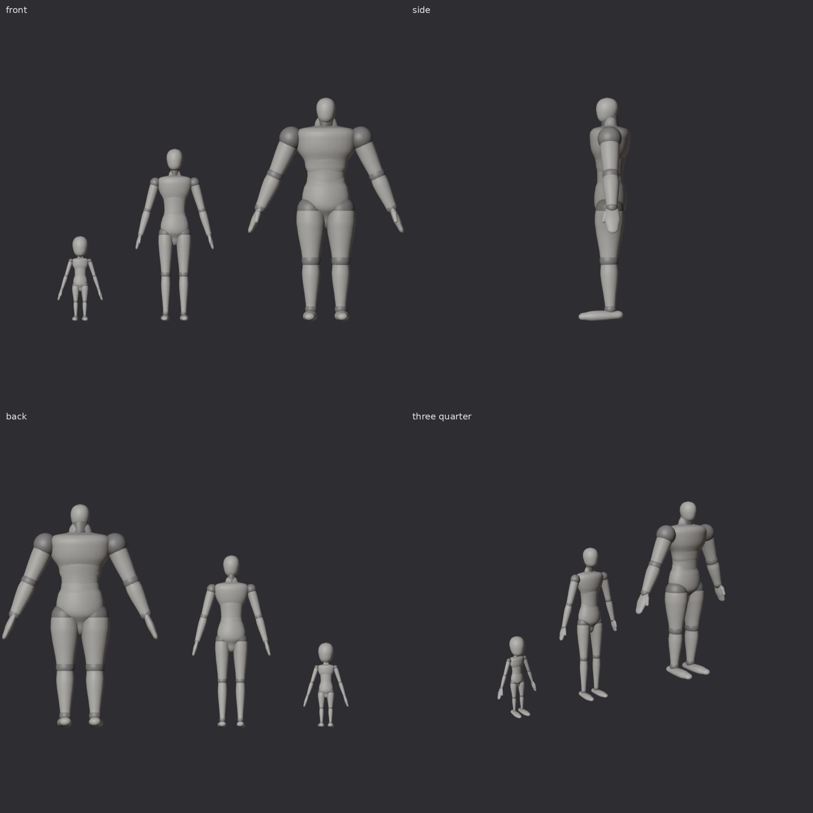

# Base bodies

Three simple, elegant bodies in the spirit of an artist's mannequin: every part is a smooth turned
form around its bone, with a visible ball at each joint (a darker material). No muscles, no face.
They share one style; each body's proportions come from its line in `Scripts/bodies.py` (`SPECS`).

| Body | Height | Mass | Proportions |
| --- | --- | --- | --- |
| Small | 0.90 m | 15 kg | Half human size: a big head, big hands and feet, short slender limbs |
| Medium | 1.83 m | 80 kg | Human: broad shoulders, narrow waist |
| Large | 2.37 m | 280 kg | Taller and much broader: wide shoulders, thick arms and legs, a small head for its size |



Close-ups and poses: `Renders/<body>.png` and `Renders/<body>_poses.png` (a guard, and a joint
stress test: the balls keep every joint closed).

16 rigid parts each, on the same null rig as the orc. Colliders are fitted to the parts and are at
least 2 cm apart at rest (scaled with the body).

## Files

| Path | What it is |
| --- | --- |
| `Assets/_Battler/Art/Bodies/<Body>/SM_<Body>_<Part>.fbx` | One mesh per part. Pivot at the origin = the joint. Drop each under the null of the same name, at zero offset. |
| `Assets/_Battler/Data/Rigs/<body>_rig.json` | Nulls (with `Aim_Head`, `Aim_Neck`, `Aim_Chest`, `Aim_Belly` points to strike at), masses, colliders, the two materials. Unity axes. |
| `FBX/REF_<Body>_Assembled.fbx` | Every part in place (flat), for viewing in Softimage or Houdini. |
| `Bodies.blend` | The three null rigs side by side with the meshes under them, colliders in hidden collections. |

## Scripts

- `bodies.py`: proportions (`SPECS`, one line per body), joint layout and masses.
- `simple.py`: the mannequin parts (the default style).
- `sculpt.py`, `anatomy.py`: an earlier, anatomical style (muscles as a signed distance field, cut
  into parts); kept for reference, built with `--sculpt`.

```
pip install bpy==5.2.3 scikit-image
python3 Scripts/build_bodies.py out                  # all three: meshes, rig files, .blend
python3 Scripts/render_bodies.py out                 # lineup and collider sheets
python3 Scripts/render_one.py out Medium              # front, side, three-quarter, head
python3 Scripts/render_pose.py out Medium             # guard and joint stress poses
```

Conventions as the orc's: Unity Y up, facing +Z, the body's right is +X; 1 unit = 1 m; feet on y = 0;
every null has identity rotation in the rest pose; FBX Forward -Z, Up Y, import at scale factor 1.
