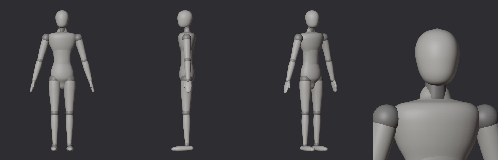
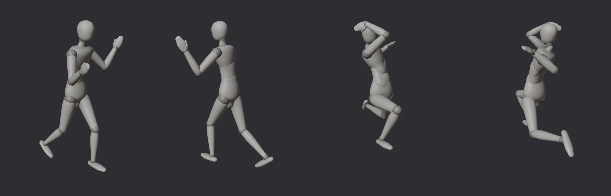

# Base bodies

A simple, elegant body in the spirit of an artist's mannequin: every part is a smooth turned form
around its bone, with a visible ball at each joint (a darker material). No muscles, no face. The
medium body is first; small and large will follow the same style once it's approved.

| Body | Height | Mass |
| --- | --- | --- |
| Medium | 1.83 m | 80 kg |




16 rigid parts on the same null rig as the orc. Colliders are fitted to the parts and are at least
2 cm apart at rest.

## Files

| Path | What it is |
| --- | --- |
| `Assets/_Battler/Art/Bodies/Medium/SM_Medium_<Part>.fbx` | One mesh per part. Pivot at the origin = the joint. Drop each under the null of the same name, at zero offset. |
| `Assets/_Battler/Data/Rigs/medium_rig.json` | Nulls (with `Aim_Head`, `Aim_Neck`, `Aim_Chest`, `Aim_Belly` points to strike at), masses, colliders, the two materials. Unity axes. |
| `FBX/REF_Medium_Assembled.fbx` | Every part in place (flat), for viewing in Softimage or Houdini. |
| `Bodies.blend` | The null rig with the meshes under it, colliders in a hidden collection. |

## Scripts

- `bodies.py`: proportions (`SPECS`, one line per body), joint layout and masses.
- `simple.py`: the mannequin parts (the default style).
- `sculpt.py`, `anatomy.py`: an earlier, anatomical style (muscles as a signed distance field, cut
  into parts); kept for reference, built with `--sculpt`.

```
pip install bpy==5.2.3 scikit-image
python3 Scripts/build_bodies.py out --only=Medium     # meshes, rig file, .blend
python3 Scripts/render_one.py out Medium              # front, side, three-quarter, head
python3 Scripts/render_pose.py out Medium             # guard and joint stress poses
```

Conventions as the orc's: Unity Y up, facing +Z, the body's right is +X; 1 unit = 1 m; feet on y = 0;
every null has identity rotation in the rest pose; FBX Forward -Z, Up Y, import at scale factor 1.
