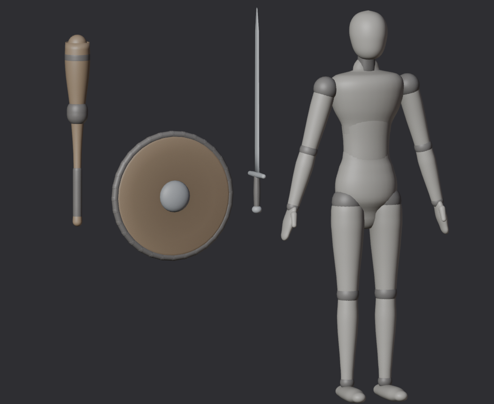

# Weapons

The milestone 2 weapons, in the mannequin style of the bodies: a sword, a one-handed club and a
round shield. Built for the medium body; units scale them with their size (leg length / 0.845 m).

```
python3 Scripts/build_weapons.py out          # FBX/SM_<Weapon>.fbx, weapons.json, Weapons.blend
python3 Scripts/render_weapons.py out ../Bodies/out Renders/weapons.png
```

Copy `out/FBX/*.fbx` to `Assets/_Battler/Art/Weapons/` and `out/weapons.json` to
`Assets/_Battler/Data/Rigs/`.

Conventions (Unity axes): the grip, where the hand's weapon slot sits, is at the origin. A sword or
club points along +Z; a sword's edges face +Y and -Y. A shield's face looks along +Z, the hand on its
grip just behind the boss. `weapons.json` gives each weapon's strike points: `tip` (thrusts),
`edge` (where a cut strikes), `head` (where a club strikes), and its colliders.


